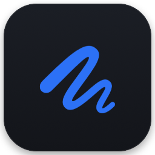

# Floaty

**Floaty** is a tiny drawing toolbar for your Mac that floats on top of everything on your screen.

I'm a creative leader, and I made it because I kept wanting to doodle over apps, websites and slides during remote calls with teammates and clients. Sometimes I need to circle something to give feedback; other times I just want to sketch a quick wireframe. Not every video call tool lets you draw, so Floaty sits on top of your screen and works with any of them. Share your screen, press a shortcut, and start sketching. Press it again and you're back to clicking around normally, with your drawings still in place until you clear them.

## See it in action

*Circling a price and sketching a quick note on a website design in Figma.*

*Adding notes on top of a design in Canva.*

## Features

- **Pencil, eraser and text** tools
- **Any color** from the color picker, with your 3 most recent colors one click away (remembered between launches)
- **Adjustable size** for the pen, eraser and text
- **Click-through mode**: drawings stay visible while you use your apps normally
- **Works on every display**, even when you plug in or unplug monitors
- **Undo** and **Clear all**
- **Easy to install**: download it, drag it into your Applications folder, and start doodling. It shows up in your Dock like any other app and needs no special permissions

## Shortcuts

| Keys | What it does |
|---|---|
| Control + Option + D | Turn drawing on/off from any app |
| Esc | Stop drawing (clicks go back to your apps) |
| P / E / T | Pencil / Eraser / Text |
| [ / ] | Smaller / bigger |
| Cmd + Z | Undo |

To add text, choose the text tool, click where you want it, type, and press Return.

## Install

1. **[Download Floaty.zip](https://github.com/guirosa-gh/Floaty/releases/latest/download/Floaty.zip)** (or grab it from the [Releases page](https://github.com/guirosa-gh/Floaty/releases)).
2. Open the zip, then drag **Floaty** into your **Applications** folder.
3. Open Floaty from Applications. Its toolbar appears on your screen and its scribble icon shows up in your Dock.

   

Works on Apple Silicon and Intel Macs running macOS 12 (Monterey) or later.

**The first time you open it**, macOS may say it can't verify the developer. That's because Floaty isn't registered with Apple's paid developer program. To open it anyway:

- Go to **System Settings → Privacy & Security**, scroll down, and click **Open Anyway** next to the message about Floaty.
- On older versions of macOS, you can instead right-click Floaty in Applications and choose **Open**.

You only need to do this once.

### Build it yourself (optional)

If you prefer to build from the source code, install Apple's free developer tools with `xcode-select --install`, download this project with the green **Code** button, then in Terminal run `bash build.sh` inside the project folder.

## What's in here

- `Floaty.swift`: the whole app
- `build.sh`: compiles the app and packages it as `Floaty.app`
- `make_icon.swift`: draws the app icon (only runs if `AppIcon.icns` is missing)
- `AppIcon.icns`: the app icon
